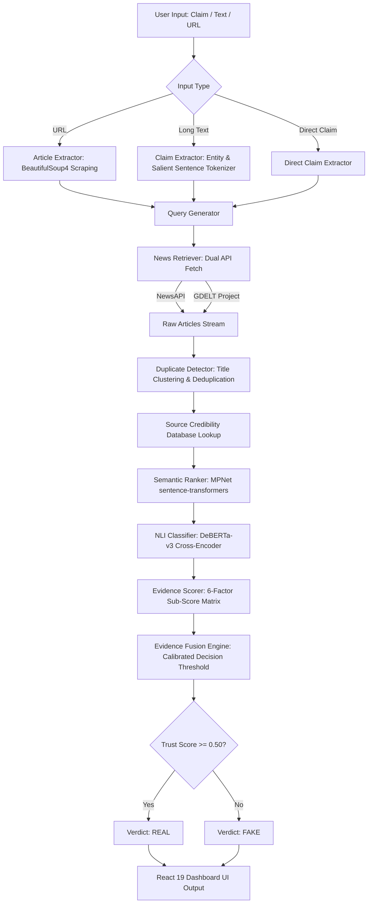

# 📜 Product Requirements Document (PRD)

## Project Name: VeriNexa — Live News & Claim Verification System
**Internal Code Name:** Truth LenX  
**Document Version:** 2.0.0  
**Status:** Active / Production Ready  
**Target Audience:** Engineering Team, Product Managers, Fact-Checkers, Security Researchers  

---

## 1. Executive Summary & Vision

### 1.1 Mission Statement
To provide an autonomous, real-time, multi-modal evidence intelligence engine that verifies online news claims, detects misinformation, and yields transparent, calibrated binary trust verdicts backed by high-credibility global reporting.

### 1.2 Problem Statement
The proliferation of AI-generated content, synthetic media ("deepfakes"), clickbait headlines, and state-sponsored misinformation campaigns has degraded public trust in digital information. Existing fact-checking solutions are either:
1. **Manual & Slow**: Human fact-checkers require hours or days to verify claims.
2. **Black-box AI**: Existing AI detectors offer non-explainable scores without citing verified external news sources.
3. **Ambiguous**: Systems produce indecisive labels like "Uncertain" or "Needs Context," leaving users without clear actionable guidance.

### 1.3 Solution Overview
**VeriNexa** automates the fact-checking lifecycle end-to-end:
- Ingests direct claims, full text, or web URLs.
- Synthesizes search queries and queries global news providers in real time (NewsAPI & GDELT).
- Eliminates echo chamber bias via near-duplicate clustering.
- Employs state-of-the-art transformer models: **MPNet** for semantic vector relevance ranking and **DeBERTa-v3** for Natural Language Inference stance detection (`SUPPORTING`, `CONTRADICTING`, `RELATED`, `INSUFFICIENT`).
- Applies domain reputation scoring and multi-factor evidence fusion to issue a binary verdict (**`REAL`** vs **`FAKE`**) with a 0.0–1.0 calibrated Trust Score.

---

## 2. User Personas & Target Use Cases

| Persona | Primary Needs | Key Features Used |
| :--- | :--- | :--- |
| **Journalist / Newsroom Editor** | Rapidly verify breaking news quotes and claims before syndication. | URL Verification, Evidence Cards, Source Independence Metrics. |
| **General News Consumer** | Instant check on viral headlines on social media (X, Reddit, WhatsApp). | Direct Claim Verification, Binary Real/Fake Verdict, Summary Explanation. |
| **Content Moderator / Platform Safety** | Programmatic API integration to flag or score unverified claims at scale. | FastAPI REST Endpoints (`/api/verify/claim`), Health Monitor Endpoint. |
| **Data Analyst / OSINT Researcher** | Deep dive into reporting clusters, source bias, and NLI stance breakdowns. | Stance Distribution Counts, Semantic Relevance Scores, System Status. |

---

## 3. Product Architecture & System Data Flow



---

## 4. Functional Requirements

### FR-1: Multi-Modal Claim Ingestion
- **FR-1.1**: The system MUST accept direct single-sentence text claims up to 1,000 characters via `/api/verify/claim`.
- **FR-1.2**: The system MUST accept long-form text (body text, press releases) up to 50,000 characters via `/api/verify/text`, automatically selecting the most salient claim sentence and extracted entities.
- **FR-1.3**: The system MUST accept public HTTP/HTTPS URLs via `/api/verify/url`, scraping headline title, article body, main domain, and publication date.

### FR-2: Automated Query Generation
- **FR-2.1**: The system MUST extract Named Entities (PER, ORG, LOC) and key action verbs from claims.
- **FR-2.2**: The system MUST generate multiple complementary query formulations (Entity-focused query, Keyword query, Strict Boolean phrase query).

### FR-3: Multi-Source Real-Time News Retrieval
- **FR-3.1**: The system MUST query NewsAPI endpoint with fallback to GDELT Project API.
- **FR-3.2**: The system MUST enforce an evidence recency window (configurable up to 10 years).
- **FR-3.3**: Retrieval failures on one provider MUST NOT fail the entire pipeline if candidate articles are retrieved from alternate sources.

### FR-4: Near-Duplicate Detection & Clustering
- **FR-4.1**: The system MUST calculate string similarity ratios and dense embedding distances between retrieved article headlines.
- **FR-4.2**: Syndicated articles (e.g., identical wire stories re-published across 20 regional domains) MUST be clustered into a single unique candidate set to prevent artificial consensus inflation.
- **FR-4.3**: The system MUST track the number of distinct independent reporting clusters.

### FR-5: Machine Learning & Stance Detection Pipeline
- **FR-5.1**: **Semantic Ranking**: The system MUST compute 768-dimensional dense vector embeddings using HuggingFace `sentence-transformers/all-mpnet-base-v2` to rank evidence by contextual relevance to the claim.
- **FR-5.2**: **NLI Stance Classification**: The system MUST pass top $K$ candidate evidence pairs $(C, E)$ through `cross-encoder/nli-deberta-v3-small` to classify the stance:
  - `SUPPORTING`: Evidence directly corroborates the claim premises.
  - `CONTRADICTING`: Evidence explicitly refutes or denies the claim premises.
  - `RELATED`: Evidence discusses the topic/entities but does not confirm or deny the core claim.
  - `INSUFFICIENT`: Evidence lacks sufficient detail or overlap.

### FR-6: Source Credibility & Reputation Engine
- **FR-6.1**: The system MUST maintain a curated domain reputation database (`source_credibility_db.json`).
- **FR-6.2**: Outlets MUST be rated across tiers:
  - **Tier 1 (Score 0.95–1.00)**: Global Wire Services (Reuters, AP, Agence France-Presse).
  - **Tier 2 (Score 0.80–0.94)**: Established National News (BBC, NYTimes, Wall Street Journal).
  - **Tier 3 (Score 0.60–0.79)**: Regional Reporting & Specialized Outlets.
  - **Tier 4 (Score 0.20–0.59)**: Unverified Blogs, Aggregators, Sensationalist Media.
  - **Tier 5 (Score 0.00–0.19)**: Tabloids, Satire, Known Misinformation Outlets.

### FR-7: Multi-Factor Evidence Fusion & Binary Decision Threshold
- **FR-7.1**: The system MUST compute a composite Trust Score $S_{\text{fused}} \in [0.0, 1.0]$ using the following mathematical formulation:

$$S_{\text{fused}} = w_{\text{sem}} \cdot S_{\text{sem}} + w_{\text{nli}} \cdot S_{\text{nli}} + w_{\text{cov}} \cdot S_{\text{cov}} + w_{\text{src}} \cdot S_{\text{src}} + w_{\text{rec}} \cdot S_{\text{rec}} + w_{\text{ind}} \cdot S_{\text{ind}}$$

Where:
- $w_{\text{sem}} = 0.30$ (Semantic Relevance)
- $w_{\text{nli}} = 0.30$ (Stance Alignment Score)
- $w_{\text{cov}} = 0.15$ (Entity Claim Coverage)
- $w_{\text{src}} = 0.10$ (Source Credibility Rank)
- $w_{\text{rec}} = 0.10$ (Publication Recency Score)
- $w_{\text{ind}} = 0.05$ (Independent Cluster Bonus)

- **FR-7.2**: **Binary Calibrated Verdict Assignment**:
$$\text{Verdict} = \begin{cases} \mathbf{REAL}, & \text{if } S_{\text{fused}} \ge 0.50 \\ \mathbf{FAKE}, & \text{if } S_{\text{fused}} < 0.50 \end{cases}$$

- **FR-7.3**: The system MUST output an explicit human-readable natural language rationale explaining the breakdown of supporting vs contradicting evidence items.

### FR-8: User Interface & Health Diagnostics
- **FR-8.1**: The application MUST present an interactive React frontend supporting direct claim entry, text pasting, and URL input.
- **FR-8.2**: The UI MUST render evidence cards with clear stance badges (`SUPPORTING`, `CONTRADICTING`, `RELATED`), credibility tags, and source domain links.
- **FR-8.3**: The system MUST provide a live System Status page (`/system-status`) displaying model initialization health (MPNet & DeBERTa readiness), database loading status, and provider response times.

---

## 5. Non-Functional Requirements (NFRs)

### NFR-1: Performance & Latency
- **NFR-1.1**: End-to-end claim verification request latency MUST be under **3.5 seconds** when models are pre-loaded in memory.
- **NFR-1.2**: Startup lifespan sequence MUST synchronously initialize HuggingFace models (`MPNet` & `DeBERTa`) so runtime requests avoid lazy-loading penalties.

### NFR-2: Availability & Resilience
- **NFR-2.1**: The FastAPI server MUST achieve 99.9% uptime for local deployment.
- **NFR-2.2**: Network timeouts for external scraping and news API calls MUST be capped at 5 seconds per request using `httpx`.

### NFR-3: Security & Privacy
- **NFR-3.1**: Input claims and scraped text MUST be processed statelessly in-memory without persistent user tracking or privacy leakage.
- **NFR-3.2**: CORS headers MUST be restricted to configured origins (`CORS_ORIGINS`).

### NFR-4: Scalability & Tech Stack Standards
- **NFR-4.1**: Backend written in **Python 3.10+** using asynchronous ASGI architecture (**FastAPI + Uvicorn**).
- **NFR-4.2**: Frontend built using **React 19 + Vite 8** with strict modular component breakdown.

---

## 6. API Data Contracts & Specifications

### 6.1 `POST /api/verify/claim`
**Request Payload:**
```json
{
  "claim": "NASA successfully landed the Perseverance rover on Mars in 2021."
}
```

**Response Payload (Sample):**
```json
{
  "status": "REAL",
  "confidence": 92.5,
  "trust_score": 0.93,
  "claim": "NASA successfully landed the Perseverance rover on Mars in 2021.",
  "input_type": "claim",
  "evidence_window": {
    "days": 3650,
    "from": "2016-10-11T13:42:00.000Z",
    "to": "2026-10-08T13:42:00.000Z"
  },
  "candidate_count": 18,
  "evidence_count": 8,
  "supporting_count": 7,
  "contradicting_count": 0,
  "related_count": 1,
  "insufficient_count": 0,
  "source_diversity": 6,
  "independent_clusters": 5,
  "evidence": [
    {
      "title": "NASA Rover Touchdown Confirmed on Mars Surface",
      "url": "https://www.reuters.com/article/us-space-exploration-mars",
      "domain": "reuters.com",
      "published_at": "2021-02-18T20:55:00Z",
      "snippet": "NASA's Mars rover Perseverance landed safely on the red planet on Thursday...",
      "relevance_score": 0.94,
      "relation": "SUPPORTING",
      "stance_confidence": 0.96,
      "source_credibility": {
        "domain": "reuters.com",
        "credibility_level": "HIGH",
        "source_type": "Wire Service",
        "score": 0.98
      }
    }
  ],
  "reason": "Claim is supported by 7 independent high-credibility news sources with 0 contradicting reports.",
  "methodology": "Dual-retrieval (NewsAPI + GDELT) -> Deduplication -> MPNet Semantic Ranking -> DeBERTa-v3 NLI -> Calibrated Fusion",
  "provider_status": {
    "newsapi": "HEALTHY",
    "gdelt": "HEALTHY"
  },
  "model_status": {
    "semantic_ranker_mpnet": "READY",
    "nli_classifier_deberta": "READY"
  }
}
```

### 6.2 `GET /api/system/status`
**Response Payload:**
```json
{
  "providers": {
    "newsapi": "HEALTHY",
    "gdelt": "HEALTHY"
  },
  "models": {
    "semantic_ranker_mpnet": "READY",
    "nli_classifier_deberta": "READY"
  },
  "source_database": "READY",
  "evidence_fusion": "READY",
  "uptime_seconds": 342.12
}
```

---

## 7. Commands & Deployment Guide

### 7.1 Development Commands

#### **Backend Execution**
```bash
# Navigate to backend
cd backend

# Activate Virtual Environment (Windows)
.\venv\Scripts\Activate.ps1

# Install / verify backend dependencies
pip install -r requirements.txt

# Launch FastAPI Dev Server with live reload
python -m uvicorn main:app --reload --port 8001
```

#### **Frontend Execution**
```bash
# Navigate to frontend
cd frontend

# Install node packages
npm install

# Launch Vite Dev Server
npm run dev
```

---

## 8. Release Horizon & Future Roadmap

- **Phase 1 (Current)**: Text claim, article URL, and long-form verification via NewsAPI + GDELT, MPNet, DeBERTa NLI, React 19 UI.
- **Phase 2 (Q3 Release)**: Cross-lingual verification supporting Spanish, French, German, and Hindi claims using Multilingual MPNet (`paraphrase-multilingual-mpnet-base-v2`).
- **Phase 3 (Q4 Release)**: Multi-modal Deepfake Image & Synthetic Audio analysis pipeline integration.
- **Phase 4 (V3 Horizon)**: Immutable blockchain audit logging for verified claim verdicts and fact-checking certificates.
